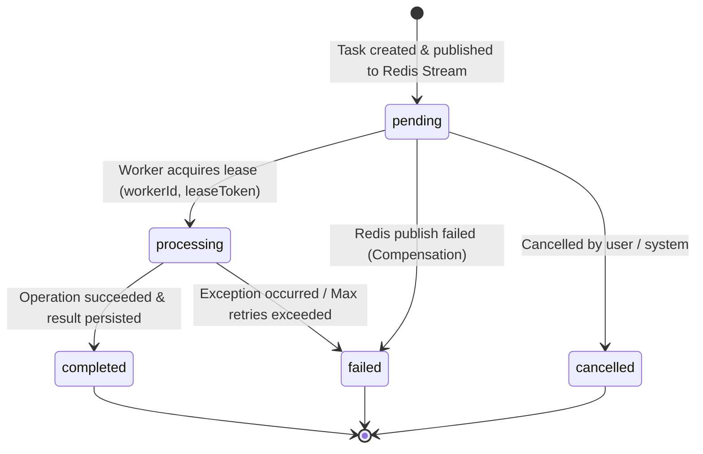
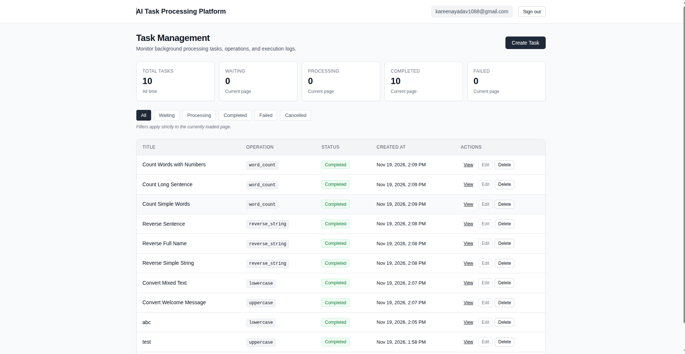
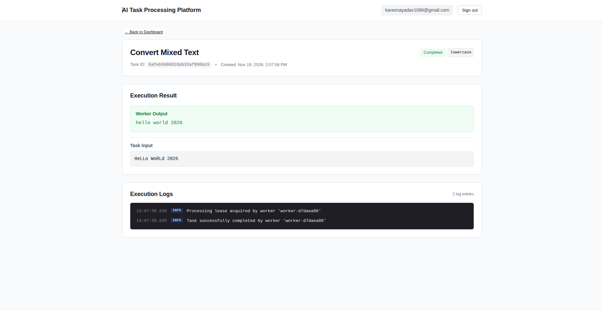

# AI Task Processing Platform

A production-grade, distributed asynchronous task processing platform built with Node.js, Express, MongoDB, Redis Streams, Python, and React. Authenticated users can submit text-processing tasks, which are queued reliably via Redis Streams and processed by background Python workers with lease-based concurrency control, real-time status tracking, and live execution logging.

---

## Table of Contents

- [Overview](#overview)
- [Features](#features)
- [Tech Stack](#tech-stack)
- [System Architecture](#system-architecture)
- [Supported Operations](#supported-operations)
- [Project Structure](#project-structure)
- [Prerequisites](#prerequisites)
- [Local Development Setup](#local-development-setup)
  - [1. Backend Setup](#1-backend-setup)
  - [2. Worker Setup](#2-worker-setup)
  - [3. Frontend Setup](#3-frontend-setup)
- [Docker Compose Setup](#docker-compose-setup)
- [Environment Variables](#environment-variables)
- [API Documentation](#api-documentation)
- [Task Lifecycle](#task-lifecycle)
- [Security Features](#security-features)
- [Application Screenshots](#application-screenshots)
- [Deployment Status](#deployment-status)

---

## Overview

The **AI Task Processing Platform** solves the problem of executing long-running or CPU-bound data and text processing workloads without blocking the primary HTTP API. 

When a user submits a task through the React interface:
1. The Express REST API validates the payload and creates a record in MongoDB with status `pending`.
2. The API enqueues the job onto a Redis Stream (`task_stream`).
3. An independent Python worker service, consuming via Redis Consumer Groups, atomically leases the task, transitions its status to `processing`, executes the functional operation, and records execution logs.
4. The worker persists the final outcome (`completed` or `failed`) back to MongoDB and acknowledges the message (`XACK`).
5. The frontend polls the API at regular intervals to display live progress, results, and execution logs.

---

## Features

- **User Authentication & Session Management**:
  - User registration and login with bcrypt password hashing (10 salt rounds).
  - Stateless JSON Web Token (JWT) authentication with configurable expiration.
  - Route guards on both frontend (protected/public route wrappers) and backend (JWT verification middleware).

- **Task Creation & Management**:
  - Create tasks with customizable title, text/JSON input, and operation type.
  - Update pending tasks (permitted fields: `title`, `operation`, `input`).
  - Delete tasks with immediate cascade cleanup.
  - Task ownership isolation: Users can only view, update, delete, or inspect logs for tasks they own.

- **Asynchronous Task Processing**:
  - Message broker architecture utilizing Redis Streams and Consumer Groups.
  - Atomic lease acquisition in MongoDB (`acquire_task_lease`) preventing race conditions and duplicate executions.
  - Automatic recovery of abandoned tasks (`XAUTOCLAIM`) if a worker crashes midway.
  - Dead-letter stream (`task_stream:dead_letter`) routing for messages exceeding retry limits (`MAX_RETRIES = 3`).

- **Supported Text Processing Operations**:
  - Pure functional processing engine supporting `uppercase`, `lowercase`, `reverse_string`, and `word_count`.

- **Live Status Tracking & Execution Logs**:
  - Task state machine: `pending` → `processing` → `completed` / `failed` (plus `cancelled`).
  - Structured execution log recording: level (`info`, `warn`, `error`, `debug`), timestamp, and message.
  - Frontend auto-polling (every 2 seconds) for active tasks, terminating automatically upon completion or error.

- **Modern Dashboard UI**:
  - Summary metrics: total tasks and status breakdown.
  - Paginated task table with client-side status filtering (`all`, `pending`, `processing`, `completed`, `failed`).
  - Modal interfaces for task creation, editing, and confirmation dialogs for deletion.
  - Detailed task inspection page with input inspection, result viewing, and a dedicated log viewer.

---

## Tech Stack

### Frontend
- **Framework**: React 19 (`^19.3.1`) with React DOM (`^19.3.1`)
- **Build Tool**: Vite 8 (`^8.3.6`)
- **Routing**: React Router DOM 7 (`^7.18.6`)
- **HTTP Client**: Axios (`^1.21.1`)
- **Production Server**: Nginx (`nginx:alpine`) reverse-proxying API traffic and serving static assets

### Backend
- **Runtime**: Node.js 22 (`node:22-alpine` in Docker)
- **Framework**: Express 5 (`^5.3.0`)
- **Database ODM**: Mongoose 9 (`^9.12.2`)
- **Redis Client**: `redis` (`^6.3.1`)
- **Schema Validation**: Zod (`^3.25.76`)
- **Authentication**: `jsonwebtoken` (`^9.0.3`) and `bcryptjs` (`^3.0.3`)
- **Security Middleware**: `helmet` (`^8.0.0`), `cors` (`^2.8.6`), `express-rate-limit` (`^8.0.0`)
- **Logging**: `pino` (`^10.4.0`)

### Worker
- **Runtime**: Python 3.12 (`python:3.12-slim` in Docker)
- **Redis Client**: `redis` (`>=5.0.0`)
- **MongoDB Driver**: `pymongo` (`>=4.6.0`)
- **Environment**: `python-dotenv` (`>=1.0.0`)

### Database & Message Broker
- **Primary Database**: MongoDB 7.0 (`mongo:7.0`)
- **Queue / Stream Broker**: Redis 7 Alpine (`redis:7-alpine`, with AOF persistence enabled)

### Containerization
- **Orchestration**: Docker Compose (v3.8 specification)
- **Multi-Stage Builds**: Non-root runtime users (`node` UID 1000, `workeruser` UID 10001, `nginx` UID 101)

---

## System Architecture

```mermaid
flowchart TD
    subgraph Client["Client Browser"]
        UI["React SPA (Port 5173 / Nginx 8080)"]
    end

    subgraph BackendGateway["Express API Gateway (Port 5000)"]
        AUTH["Auth Router (/api/auth)"]
        TASKS["Task Router (/api/tasks)"]
        VAL["Zod Validation & Rate Limiters"]
        PROD["Queue Service (Producer)"]
    end

    subgraph DataTier["Data Tier"]
        MONGO[("MongoDB 7.0\n(Collections: users, tasks)")]
        REDIS[("Redis 7.0\nStream: task_stream\nConsumer Group: task_workers_group")]
    end

    subgraph WorkerTier["Worker Tier (Python 3.12)"]
        CONSUMER["Stream Consumer (XREADGROUP / XAUTOCLAIM)"]
        ENGINE["Functional Processing Engine\n(uppercase, lowercase, reverse_string, word_count)"]
        LEASE["Lease Manager & Atomic DB Updater"]
    end

    UI -->|1. Register / Login / Submit Task| VAL
    VAL --> AUTH
    VAL --> TASKS
    AUTH <-->|User verification & Bcrypt| MONGO
    TASKS -->|2. Create task record (pending)| MONGO
    TASKS -->|3. Publish job (XADD)| PROD
    PROD -->|task_stream| REDIS
    
    REDIS -->|4. Pull message| CONSUMER
    CONSUMER -->|5. Atomically acquire lease (processing)| LEASE
    LEASE <-->|Set workerId, leaseToken, leaseExpiresAt| MONGO
    CONSUMER -->|6. Execute operation| ENGINE
    ENGINE -->|7. Return computed string| LEASE
    LEASE -->|8. Update status completed/failed & append logs| MONGO
    CONSUMER -->|9. Acknowledge message (XACK)| REDIS

    UI -.->|10. Live polling GET /tasks/:id & /logs (2s interval)| TASKS
    TASKS -.->|Read status, result, logs| MONGO
```

### Asynchronous Processing Workflow

1. **Job Enqueueing**: Upon receiving a valid task payload, the Express API creates a MongoDB document in `pending` status. It then calls `xAdd("task_stream", "*", payload)`. If Redis enqueueing fails, an automated compensation mechanism updates the MongoDB record to `failed` and logs the diagnostic error.
2. **Consumer Group Processing**: Python workers subscribe to `task_stream` using consumer group `task_workers_group` and a unique consumer identifier (`worker-<uuid>`).
3. **Atomic Leases & Distributed Concurrency**: Before executing a task, the worker issues an atomic conditional update (`find_one_and_update`) in MongoDB checking that the task is `pending` or has an expired lease. A fresh `leaseToken` and TTL (`PROCESSING_LEASE_SECONDS = 60`) are set.
4. **Execution & Acknowledgment**: The worker processes the string via the functional engine. Once MongoDB has successfully committed the result and logs (verified against the active `leaseToken`), the worker issues `XACK` to Redis.
5. **Fault Recovery & Dead-Letter Routing**: Abandoned tasks from dead workers are claimed via `XAUTOCLAIM` after `AUTOCLAIM_MIN_IDLE_MS` (70s). Messages exceeding `MAX_RETRIES` (3) are transferred via an atomic Lua script to `task_stream:dead_letter` and marked as `failed` in MongoDB.

---

## Supported Operations

The functional processing engine (`worker/engine.py`) provides pure string transformations. Results are converted to strings to match the MongoDB schema.

| Operation Identifier | Description | Example Input | Example Output |
|----------------------|-------------|---------------|----------------|
| `uppercase` | Converts text to uppercase (Unicode-preserving) | `"hello world"` | `"HELLO WORLD"` |
| `lowercase` | Converts text to lowercase (Unicode-preserving) | `"Hello WORLD"` | `"hello world"` |
| `reverse_string` | Reverses string character sequence | `"Distributed Systems"` | `"smetsyS detubirtsiD"` |
| `word_count` | Counts whitespace-delimited words | `"Process tasks asynchronously with Redis"` | `"5"` |

---

## Project Structure

```
AI-Task-Processing-Platform/
├── .env.example                  # Root environment template for Docker Compose
├── .gitignore                    # Git ignore rules
├── docker-compose.yml            # Multi-container orchestration definition
├── README.md                     # Project documentation
├── assests/                      # Application screenshots
├── backend/
│   ├── .env.example              # Backend environment template
│   ├── Dockerfile                # Multi-stage production build for Node API
│   ├── package.json              # Backend dependencies and scripts
│   ├── package-lock.json
│   └── src/
│       ├── app.js                # Express app initialization & middleware stack
│       ├── server.js             # HTTP server entrypoint & graceful shutdown
│       ├── config/               # Database, Redis, Auth, and Logger configs
│       ├── controllers/          # Request handlers (authController, taskController)
│       ├── middlewares/          # Auth, CORS, Helmet, RateLimit, Error handling
│       ├── models/               # Mongoose schemas (User, Task)
│       ├── routes/               # API routes (authRoutes, taskRoutes)
│       ├── services/             # Business logic (authService, taskService, queueService)
│       ├── utils/                # Custom AppError and JWT token helpers
│       └── validators/           # Zod schema definitions
├── frontend/
│   ├── Dockerfile                # Multi-stage build (Vite build + Nginx runner)
│   ├── index.html                # HTML entrypoint
│   ├── nginx.conf                # Nginx reverse proxy configuration
│   ├── package.json              # Frontend dependencies and scripts
│   ├── package-lock.json
│   ├── vite.config.js            # Vite build configuration
│   ├── public/                   # Static icons and assets
│   └── src/
│       ├── App.jsx               # Application routes & layout
│       ├── main.jsx              # React DOM mounting
│       ├── api/                  # Axios HTTP client and API service wrappers
│       ├── components/           # UI components, modals, tables, and navbars
│       ├── context/              # Authentication context provider
│       ├── hooks/                # Custom hooks (useAuth, useTaskPolling)
│       ├── pages/                # Page views (Dashboard, Details, Login, Register)
│       └── styles/               # CSS modules and stylesheets
└── worker/
    ├── .env.example              # Worker environment template
    ├── Dockerfile                # Multi-stage build for Python worker
    ├── requirements.txt          # Python dependencies
    ├── config.py                 # Configuration loader and credential masking
    ├── db.py                     # MongoDB connection & atomic lease manager
    ├── engine.py                 # Pure functional text-processing operations
    ├── main.py                   # Worker consumer loop & signal handling
    └── redis_client.py           # Redis Streams client, XAUTOCLAIM & DLQ handler
```

---

## Prerequisites

Before setting up the project locally, ensure the following dependencies are installed on your machine:

- **Node.js**: `v20.x` or `v22.x` (`v22` used in container images)
- **npm**: `v10.x` or later
- **Python**: `v3.12.x` (or `3.10+`)
- **Docker & Docker Compose**: Docker Engine 24+ and Docker Compose v2 (for containerized setup)
- **MongoDB**: `v7.0+` (if running services natively without Docker)
- **Redis**: `v7.0+` (if running services natively without Docker)

---

## Local Development Setup

To run each service natively on your host machine for development:

### 1. Backend Setup

```bash
cd backend

# Install dependencies
npm install

# Copy environment configuration
cp .env.example .env

# Configure .env with your local MongoDB and Redis connection strings
# Start backend in development mode (hot-reloading via node --watch)
npm run dev
```
*The backend server runs on `http://localhost:5000`.*

### 2. Worker Setup

```bash
cd worker

# Create and activate Python virtual environment
python3 -m venv venv
source venv/bin/activate
# On Windows: venv\Scripts\activate

# Install dependencies
pip install --upgrade pip
pip install -r requirements.txt

# Copy environment configuration
cp .env.example .env

# Configure .env with local Redis and MongoDB connections
# Start worker process
python main.py
```

### 3. Frontend Setup

```bash
cd frontend

# Install dependencies
npm install

# Start Vite development server
npm run dev
```
*The frontend client runs on `http://localhost:5173`.*

---

## Docker Compose Setup

The easiest way to run the entire distributed system (Frontend, Backend, Worker, MongoDB, and Redis) is with Docker Compose.

### 1. Configure Environment

Copy the example environment configuration to the project root:

```bash
cp .env.example .env
```

*(Edit `.env` if you need custom port mappings or custom secrets).*

### 2. Build and Start Services

Build all multi-stage container images and launch the stack in detached mode:

```bash
sudo docker compose up --build -d
```

### 3. Verify Running Containers

Check that all 5 services are healthy and running:

```bash
sudo docker compose ps
```

Expected running containers:
- `ai-platform-frontend`
- `ai-platform-backend`
- `ai-platform-worker`
- `ai-platform-mongodb`
- `ai-platform-redis`

View aggregate logs or logs for a specific service:

```bash
# Follow aggregate logs
sudo docker compose logs -f

# Follow worker logs specifically
sudo docker compose logs -f worker
```

### 4. Exposed Network Ports

| Container | Internal Port | Exposed Host Port | Purpose |
|-----------|---------------|-------------------|---------|
| `frontend` | `8080` | `5173` | React web application served via Nginx |
| `backend` | `5000` | `5000` | Express REST API Gateway |
| `mongodb` | `27017` | *Internal only* | Application data store (accessible within `app-network`) |
| `redis` | `6379` | *Internal only* | Streams and task broker (accessible within `app-network`) |
| `worker` | N/A | *Internal only* | Python background processing daemon |

### 5. Stopping Containers

To stop running containers while preserving persistent volumes (MongoDB data and Redis append-only files):

```bash
sudo docker compose down
```

To stop containers and delete database volumes:

```bash
sudo docker compose down -v
```

---

## Environment Variables

Safe templates are provided in `.env.example`, `backend/.env.example`, and `worker/.env.example`.

### Docker Compose & Root (`.env.example`)

| Variable | Description | Safe Example Placeholder |
|----------|-------------|--------------------------|
| `FRONTEND_PORT` | Host port mapped to frontend container | `5173` |
| `BACKEND_PORT` | Host port mapped to backend API | `5000` |
| `JWT_SECRET` | Secret key used to sign and verify JWT tokens (min 32 characters) | `your_secure_random_jwt_secret_change_me_32char` |
| `JWT_EXPIRES_IN` | Token validity duration | `1d` |
| `CORS_ORIGIN` | Comma-separated list of allowed client origins | `http://localhost:5173,http://127.0.0.1:5173,http://localhost:8080` |
| `MONGODB_URI` | MongoDB connection connection string | `mongodb://mongodb:27017/ai-task-platform` |
| `REDIS_URL` | Redis connection URL | `redis://redis:6379` |
| `REDIS_STREAM` | Redis Stream name for queuing tasks | `task_stream` |
| `REDIS_CONSUMER_GROUP` | Consumer group name for task workers | `task_workers_group` |
| `REDIS_CONSUMER_NAME` | Worker consumer identity (empty auto-generates UUID) | `worker-1` |
| `REDIS_BLOCK_MS` | Block time (ms) for `XREADGROUP` polling | `2000` |
| `REDIS_BATCH_SIZE` | Batch size for fetching stream messages | `10` |
| `PROCESSING_LEASE_SECONDS` | Lease duration (s) granted to a worker in MongoDB | `60` |
| `AUTOCLAIM_MIN_IDLE_MS` | Minimum idle time (ms) before reclaiming abandoned tasks | `70000` |
| `RECOVERY_POLLING_INTERVAL_SECONDS` | Polling frequency (s) for dead worker recovery | `10.0` |
| `MAX_RETRIES` | Max delivery attempts before moving message to DLQ | `3` |
| `DEAD_LETTER_STREAM` | Redis Stream name for dead-letter messages | `task_stream:dead_letter` |

### Backend Specific (`backend/.env.example`)

| Variable | Description | Safe Example Placeholder |
|----------|-------------|--------------------------|
| `PORT` | Local port for Express API | `5000` |
| `NODE_ENV` | Node environment (`development` or `production`) | `development` |
| `LOG_LEVEL` | Pino logging level (`info`, `debug`, `warn`, `error`) | `info` |
| `MAX_REQUEST_SIZE` | Express JSON request body size limit | `1mb` |

### Worker Specific (`worker/.env.example`)

| Variable | Description | Safe Example Placeholder |
|----------|-------------|--------------------------|
| `MONGODB_DATABASE` | Target MongoDB database name | `ai-task-platform` |

---

## API Documentation

All routes under `/api/tasks` and `/api/auth/me` require authentication via a standard HTTP Header:
`Authorization: Bearer <jwt_token>`

| Method | Endpoint | Description | Auth Required | Rate Limit |
|--------|----------|-------------|:-------------:|:----------:|
| `GET` | `/health` | API health check probe | No | None |
| `POST` | `/api/auth/register` | Register a new user account | No | 5 requests / 15 min |
| `POST` | `/api/auth/login` | Authenticate user credentials & receive JWT | No | 5 failures / 15 min |
| `GET` | `/api/auth/me` | Fetch profile information for authenticated user | Yes | 100 requests / 15 min |
| `POST` | `/api/tasks` | Create a new task and publish to Redis Stream | Yes | 100 requests / 15 min |
| `GET` | `/api/tasks` | List user's tasks (Query: `page`, `limit`) | Yes | 100 requests / 15 min |
| `GET` | `/api/tasks/:taskId` | Retrieve detailed task status, input, and result | Yes | 1,200 requests / 15 min |
| `PATCH` | `/api/tasks/:taskId` | Update pending task (`title`, `operation`, `input`) | Yes | 100 requests / 15 min |
| `DELETE` | `/api/tasks/:taskId` | Delete a task owned by user | Yes | 100 requests / 15 min |
| `GET` | `/api/tasks/:taskId/logs` | Retrieve execution logs for a task | Yes | 1,200 requests / 15 min |

---

## Task Lifecycle



- **`pending`**: The task has been validated and persisted in MongoDB. A message has been dispatched to Redis Streams. Only tasks in `pending` status may be edited via `PATCH /api/tasks/:taskId`.
- **`processing`**: A Python worker has claimed the task and acquired an atomic MongoDB lease (`acquire_task_lease`), setting `workerId`, `leaseToken`, and `startedAt`.
- **`completed`**: The functional operation succeeded. The computed string is stored in `result`, `completedAt` is recorded, and execution logs are appended.
- **`failed`**: The task encountered an unrecoverable error, an engine exception, or exceeded the maximum retry delivery count (`MAX_RETRIES = 3`).
- **`cancelled`**: Supported terminal status in schema and concurrency filters.

---

## Security Features

- **Password Security**: Passwords hashed with `bcryptjs` using 10 salt rounds before storage. Plaintext passwords and hashes are excluded from query projections and JSON responses.
- **JWT Authentication**: Secure token verification middleware verifying signature and user existence.
- **HTTP Security Headers**: `helmet` enabled to sanitize response headers and guard against common web vulnerabilities (XSS, clickjacking, MIME-sniffing).
- **Strict Input Validation**: Zod schemas validate parameter types, string lengths, and email formats on every route. Unknown parameters on updates are strictly rejected.
- **Granular Rate Limiting**: Dedicated rate limiters configured via `express-rate-limit`:
  - `loginLimiter`: 5 failed attempts per 15-minute window.
  - `registerLimiter`: 5 registration attempts per 15-minute window.
  - `apiLimiter`: 100 general requests per 15-minute window.
  - `pollingLimiter`: 1,200 requests per 15-minute window to support high-frequency UI status polling.
- **CORS Protection**: Restricted to explicitly whitelisted client origins defined in `CORS_ORIGIN`.
- **Request Size Guardrails**: JSON request bodies restricted to `1mb` (configurable via `MAX_REQUEST_SIZE`), and urlencoded payloads limited to `50kb`.
- **Least-Privilege Containers**: Container images execute as non-root users (`node`, `workeruser`, `nginx`).
- **Sensitive Data Masking**: Database and Redis connection strings with credentials are masked in logs and runtime error messages.

---

## Application Screenshots

### 1. Task Management Dashboard
The main dashboard provides an overview of aggregate system metrics, a filterable and paginated task list, and modal dialogs to submit new text-processing tasks or edit pending tasks.



### 2. Task Execution Details
The detailed task view displays the original input payload, worker operation output, lifecycle status, error details (if any), and live-streamed background execution logs.



---

## Deployment Status

- **Docker Compose (Local)**: **Verified & Operational**. All five containers (`frontend`, `backend`, `worker`, `mongodb`, and `redis`) build cleanly and communicate over the internal bridge network.
- **Application Functionality**: **Verified**. User registration, authentication, task creation, queue publishing, background worker execution, atomic lease locking, and UI log polling have been verified locally.
- **Kubernetes & Argo CD**: **Not Implemented / Unverified**. Kubernetes deployment manifests and GitOps pipelines with Argo CD are not configured in this repository.
